# Writer

**A writing app for books of every kind, on your computer and your phone, kept in plain files and synced through GitHub.** Writer keeps each book as Markdown and YAML files in a git repository. You write in a calm editor, with the book's structure and index beside the text, while GitHub keeps every version, backs it up, and tracks the work around the book as issues. You never have to type a git command.

Each book stands on your shelf: a novel is one book, and so is a journal or a campaign. Each kind of book has its own words, structure and features.

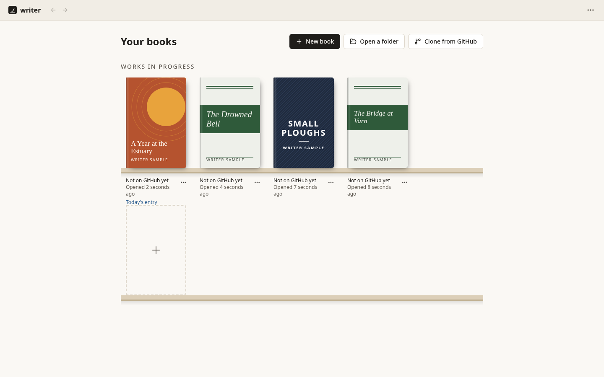

## Kinds of book

| Kind | Its structure | Its index | What it has of its own |
|---|---|---|---|
| **Novel** | Parts, chapters and scenes | Story bible: characters, locations, plotlines, themes | Point of view, plotlines, off-page events, a drafting board, standard manuscript format |
| **Journal** | Years (if you want them), months and entries | Index: people, places, events, values | Today's entry, the Journal page, a calendar |
| **Campaign** | Arcs and sessions | Codex: NPCs, player characters, locations, factions, items, quests | A prep sheet for every session, notes from the table |
| **Non-fiction book** | Parts (if you want them), chapters and sections | Index: sources, people, concepts, claims | Citations from footnotes, and a bibliography |

Writer doesn't try to be everything to everyone. A feature that only some kinds want is a module those kinds use, not a part of every book ([D14](https://github.com/heffrey78/writer/issues/10)). A journal keeper never sees the word "scene".

Writer grew out of [gh-writer](https://github.com/heffrey78/gh-writer), a novel-writing app. Books from gh-writer open in Writer unchanged ([#2](https://github.com/heffrey78/writer/issues/2)), and the shelf offers to bring them in.

### Journal

A journal opens on its **Journal** page: today at the top, ready to type in, and every earlier entry below it, newest first, each editable where it is. Today's entry is made in its month with your first words. Nothing is made if you don't type. A journal kept as a novel in gh-writer becomes a Journal in one step, with every ID and mention kept.

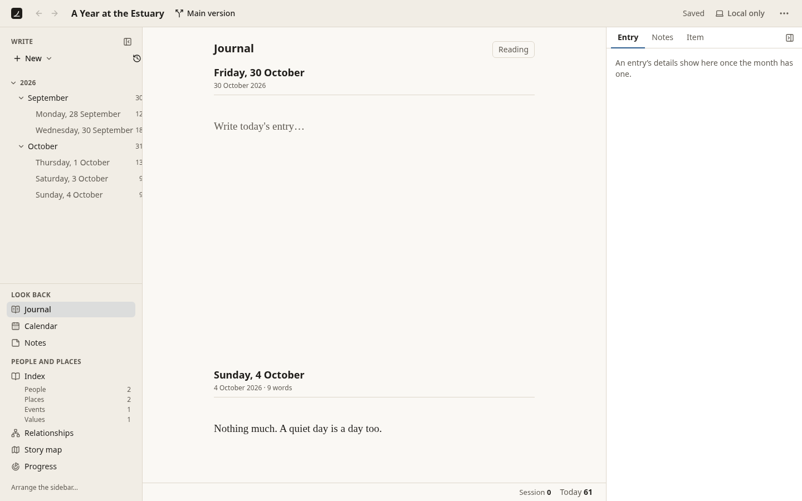

### Campaign

A session starts as a prep sheet (strong start, scenes, secrets and clues, NPCs, locations, treasure) with a place for what happened at the table. Sessions go from planned to prepped to played. Relationships change at a session, so the graph shows the campaign as it moves. There are no dice or rules: Writer plans and remembers, and the table plays. This kind is still being refined with the game master who'll use it ([#6](https://github.com/heffrey78/writer/issues/6)).

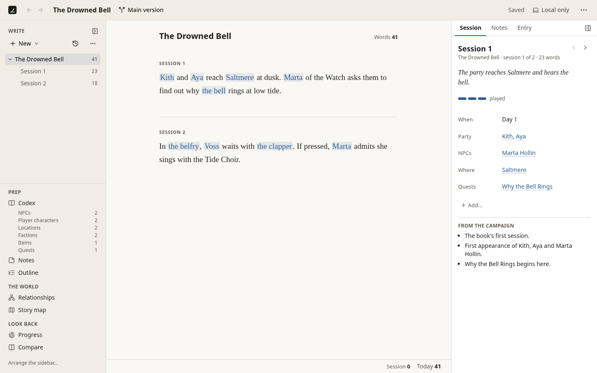

### Non-fiction

Sections go from outline to draft, revised and checked. A footnote cites a source by mentioning it from the index. Compiled, it reads as the short form ("Darwin, Vegetable Mould"), and the book ends with a bibliography of the sources it draws on.

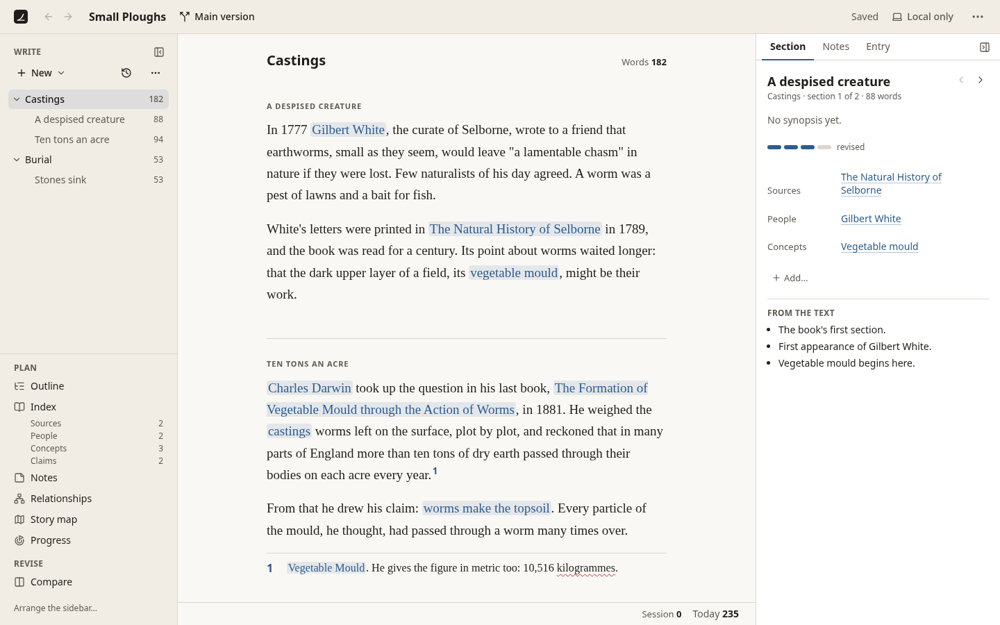

### Novel

Everything gh-writer does, as the first kind.

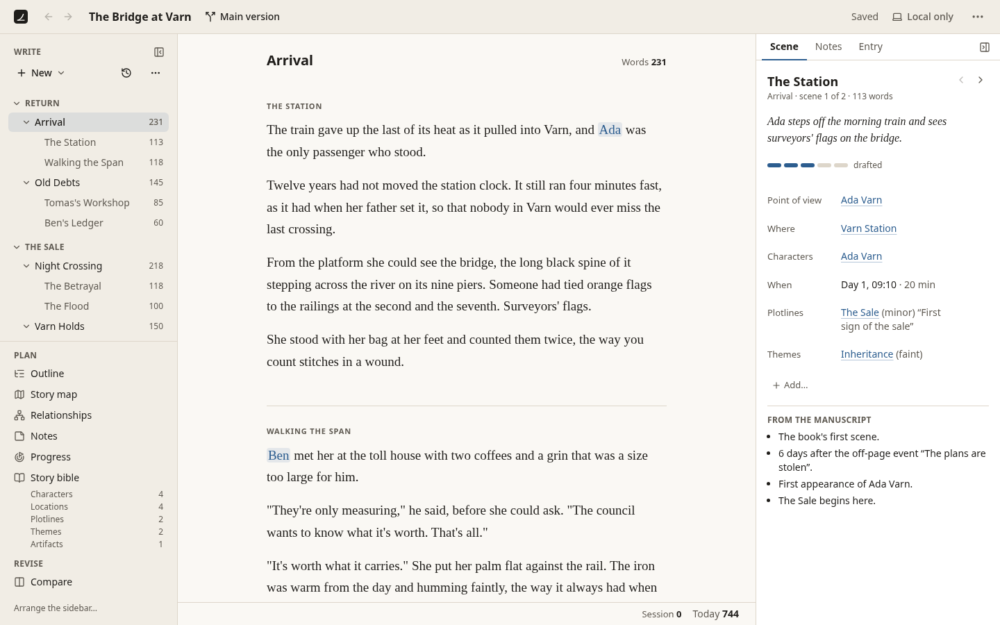

## Features

Examples here are from the sample novel, *The Bridge at Varn*. Unless it says otherwise, every kind has the feature, in its own words.

### Write

- **A distraction-free editor** for a single piece, or a whole chapter or month as one continuous text while each piece stays its own file. Focus mode, typewriter scrolling, word counts, and today's words against a daily goal.
- **Mentions.** Type `@` and a few letters to mention anything in the book's index. Hover over a mention (or press Alt+Enter) for a card showing who they are and how they relate to everyone else *at that point in the book*.
- **A sidebar beside the text**: the piece the caret is in as a readable card, each detail edited in place, with what the rest of the book says about it ("8 h after “The Station”", "First appearance of Ben Varn"); its notes; and any index entry as its profile. Ctrl+Shift+\\ hides and shows it.
- **Quick entry.** Create a new entry straight from the `@` menu or the piece's card, without leaving the text.
- **Dictation.** Speak, and the words are written where the caret is. They're heard on the device by a speech model you download once, and audio never leaves it. English for now, in the Linux and Android apps ([#71](https://github.com/heffrey78/writer/issues/71)).
- **Footnotes and pictures** in the text, kept in plain Markdown. Tables, headings and lists too.
- **Spell check** that knows the names in your index, with a dictionary for each book.
- **Progress** from the book's own history: words added and cut each day, the length against a target and deadline with a projected finish, a daily goal with a streak.
- **Find and replace** across the piece, the chapter or the whole book, with one Undo for everything.
- **Autosave that doesn't lose words**, even if the app crashes, and conflicts shown side by side if a file changes elsewhere.

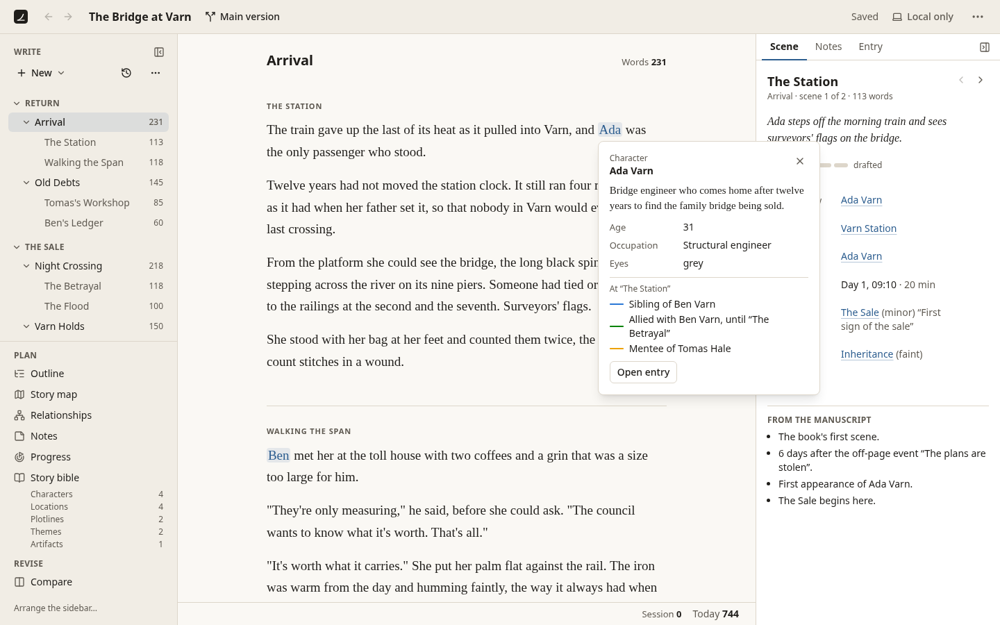

<table>
  <tr>
    <td>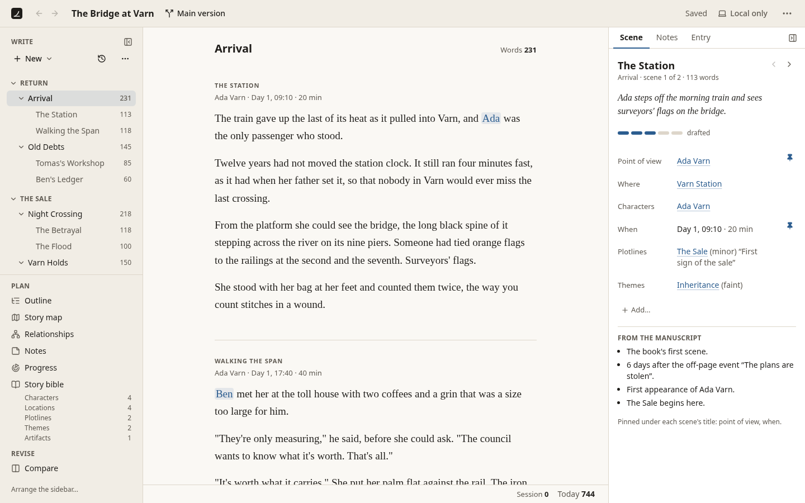</td>
    <td>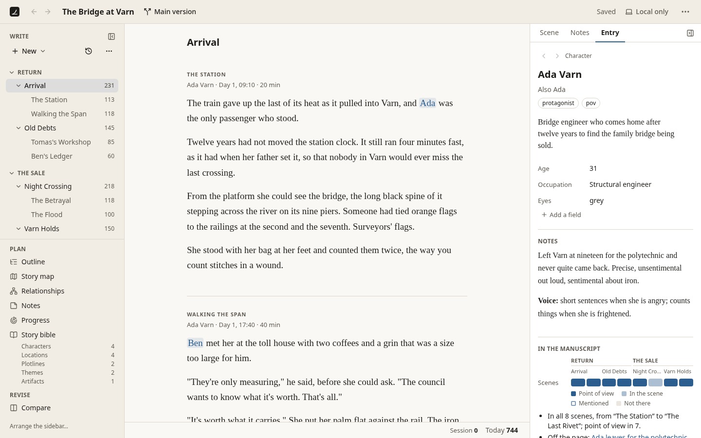</td>
  </tr>
</table>

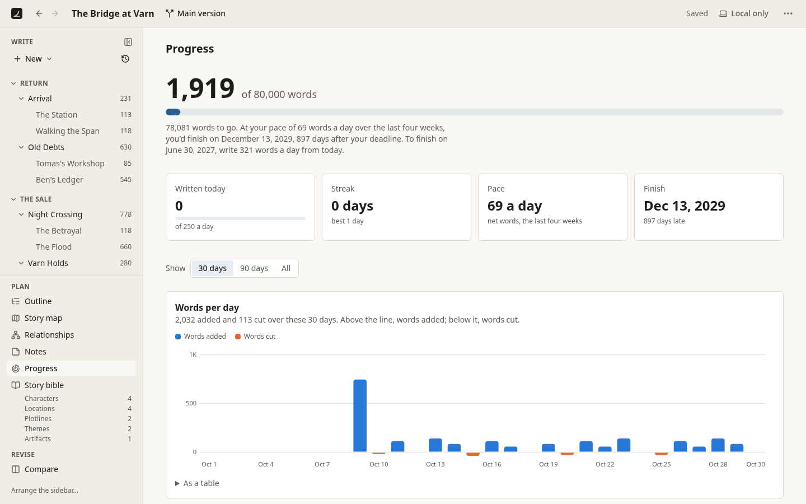

### Plan

- **The book's structure** in a tree you can rearrange with the keyboard or by dragging, and an **outline** of every piece as a table or as index cards, filtered by what's in it. A novel's outline is also a drafting board, which can be mirrored on a GitHub Project.
- **An index** of entries of your kind's types and types you invent, as a gallery of cards and a profile for each entry, read first and edited in place: where it is across the book, piece by piece, and its relationships as arcs that start and end at particular pieces, in colours that stay readable for colour-blind readers. The same relationships are drawn as a **relationship graph** with a slider to step through the book and watch alliances change.
- **A story map** of the book's elements against its pieces, exportable as SVG (and some as Mermaid). Which tabs it has depends on the kind:
  - **presence** of people, places and ideas in each piece (every kind);
  - a **timeline** setting story time against reading order, flashbacks and off-page events included (novel, journal and campaign);
  - **plotlines** showing each one's beats scene by scene, and where one goes quiet (novel).
- **A sidebar you can arrange.** Each kind has its own groups and order. Move or hide pages from *Arrange the sidebar…*, and the arrangement is kept in the book, so it's the same on every device.

<table>
  <tr>
    <td>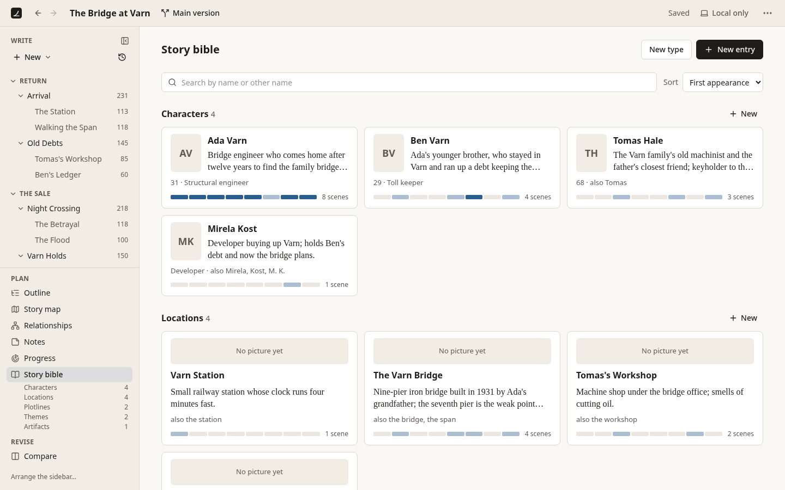</td>
    <td>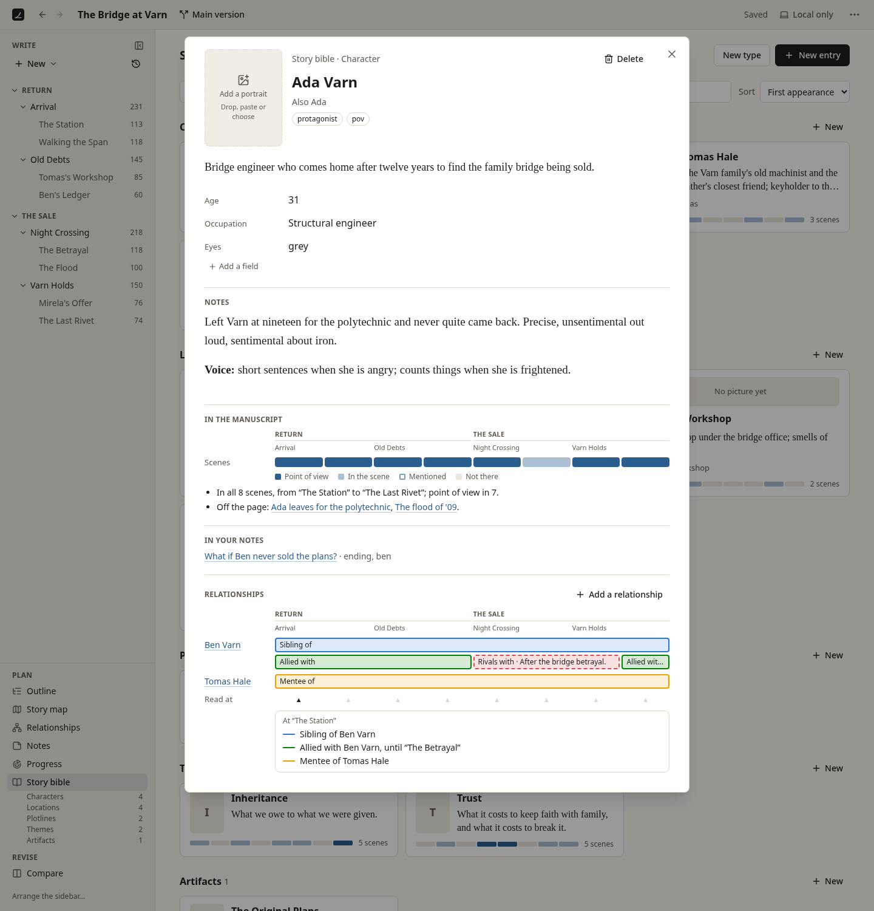</td>
  </tr>
  <tr>
    <td>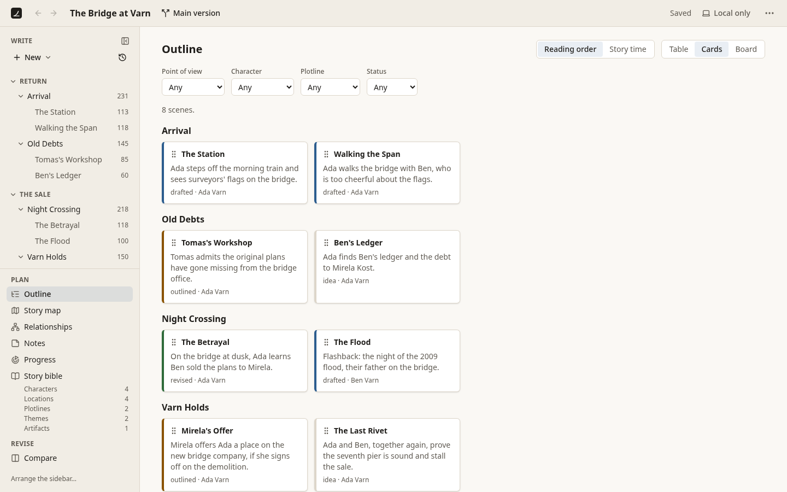</td>
    <td>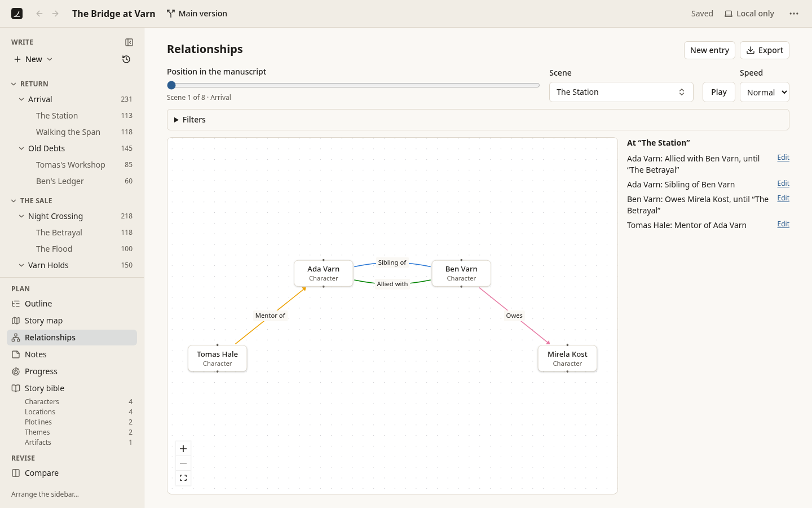</td>
  </tr>
  <tr>
    <td>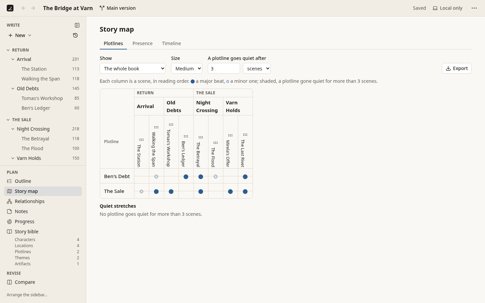</td>
    <td>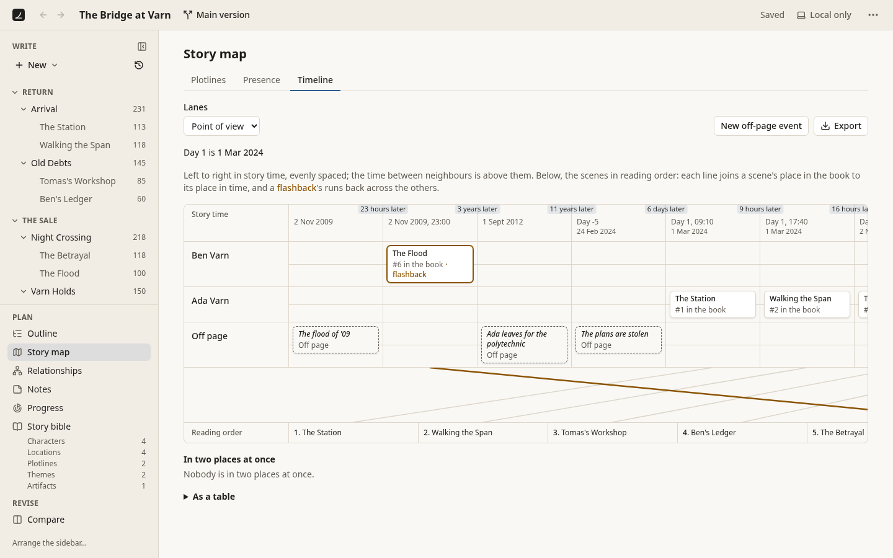</td>
  </tr>
</table>

### Revise

- **Drafts** hold the book's history in one place: its versions, each with its checkpoints.
- **Checkpoints** are named moments in a version ("Before the big cut") to restore the whole book, or one piece, from. Every restore can be undone.
- **Versions** let you try a different ending or a big cut alongside the main book, prose and index both. Switch between them whenever you like, then **adopt** one into the main version (what changed in the main version meanwhile is kept) or **bring single pieces across**, or discard it, kept in a checkpoint in case you want it back.
- **Compare** any two of now, a version and a checkpoint, the way an editor marks up a manuscript: deleted words struck through, inserted words underlined, with what changed in each piece's details, the index and the relationships, and word counts before and after.

<table>
  <tr>
    <td>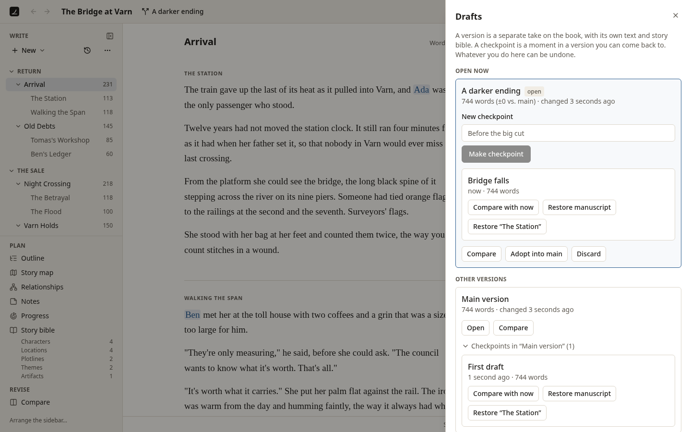</td>
    <td>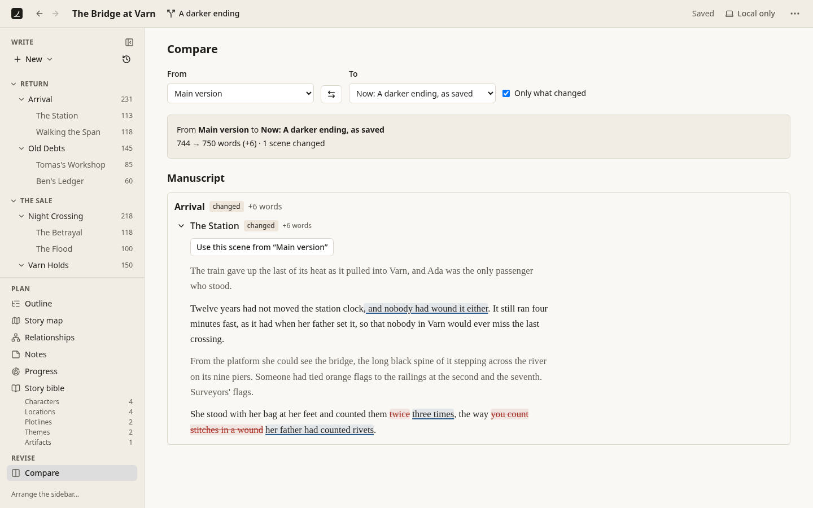</td>
  </tr>
</table>

### Work with GitHub

- **Sync** with a GitHub repository in the background: the book, its checkpoints and its versions, so every computer and phone you write on has them.
- **Sign in once in the app**; the token stays in your system's keychain. Start a new book, clone one, or put a local book on GitHub, all from the app.
- **Issues for the work around the book**, with kinds that suit the book (a novel's plot holes, a campaign's loose ends, a non-fiction book's fact checks), labels for the entries involved, and milestones. Select a passage to raise an issue about it; a marker in the margin leads back to it. Changes made offline go to GitHub when it can be reached.
- **Diagram snapshots on github.com**: a workflow redraws the diagrams into the repository on every push, so they show up when you browse it.

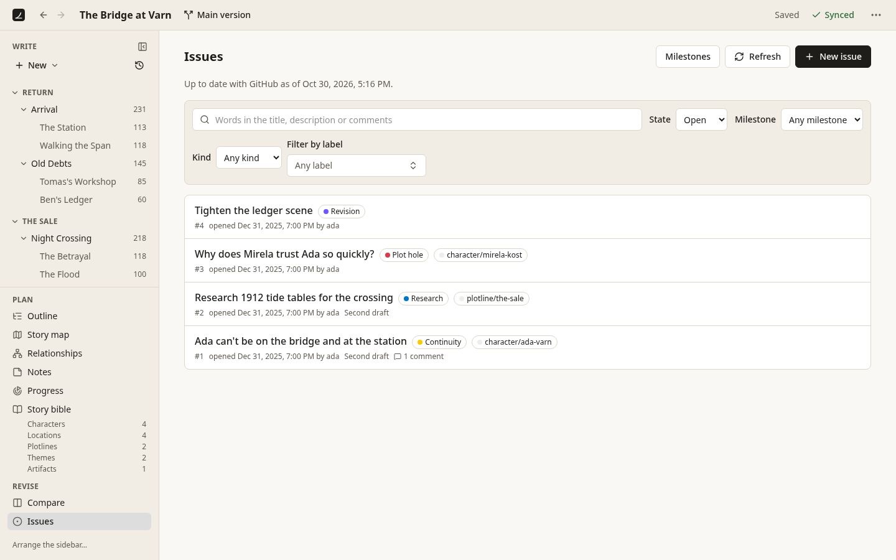

### Compile

- **Compile the book**, or a range of chapters, to **Word**, **EPUB** (checked by epubcheck) and **PDF**. A novel comes out in standard manuscript format, ready for agents and editors. Presets in `compile.yaml` set the title page, chapter headings, breaks, and front and back matter.
- **A Release for every named checkpoint**: a workflow in the book's repository compiles it and attaches the files. The same commit gives byte-identical files in the app and on GitHub.

Compiling is on the desktop, the command line and GitHub. The Android app doesn't offer it yet.

### On a phone

The Android app opens, edits and syncs the same books, with no server or other app needed. At phone width the text has the whole screen: a bar at the bottom holds four of the book's pages and More, the page's name opens a search of entries or scenes, and a bar above the keyboard holds the palette, Dictate, Undo, Redo and `@`. Unsaved words survive the app being killed.

<table>
  <tr>
    <td>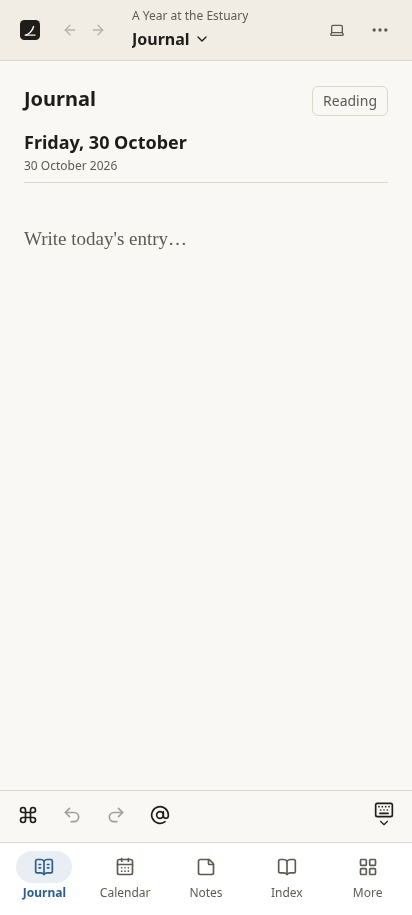</td>
    <td>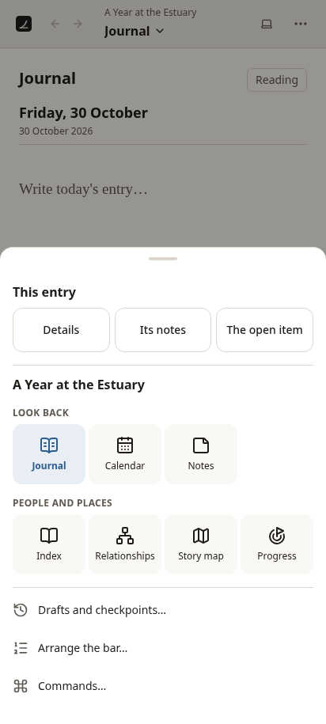</td>
  </tr>
</table>

### Your files, your way

Everything is in plain files: one Markdown file per piece, one per index entry, YAML for structure and relationships. You can edit them on github.com or in any text editor, and a validator (run on every push) catches broken references. The format is specified in [docs/format/v3.md](docs/format/v3.md).

The app is keyboard-first and accessible: a command palette (Ctrl+K / ⌘K) reaches everything, every view works without a mouse, it follows your light or dark setting, and its screens are checked with axe in the test suite.

## Getting started

There's no signed release yet. These are the ways to run Writer today:

| Where | How |
|---|---|
| **Android** | Install [`writer-android.apk`](https://github.com/heffrey78/writer/releases/download/android-latest/writer-android.apk) from the [Android (latest)](https://github.com/heffrey78/writer/releases/tag/android-latest) pre-release, rebuilt from every passing push to main. |
| **Windows, Mac with Apple silicon** | Unsigned test builds, on the [Desktop (test builds)](https://github.com/heffrey78/writer/releases/tag/desktop-test-builds) pre-release, which says how to open them. Dictation isn't checked on them yet. |
| **Linux desktop app** | Build it from source: `npm run desktop:arch` for an Arch package, or the .deb ([DEVELOPER.md](DEVELOPER.md#the-desktop-app)). |
| **In a browser, anywhere** | From source, as below. Dictation needs one of the apps. |

From source, you need [Node.js](https://nodejs.org) 22.18 or later and [git](https://git-scm.com):

```sh
git clone https://github.com/heffrey78/writer
cd writer
npm install
npm run build
npx writer serve
```

Your browser opens on your shelf, where you can start a new book of any kind, open a folder or clone one from GitHub. To try a sample book, use `npx writer serve examples/sample-novel`, or `sample-journal`, `sample-campaign` or `sample-nonfiction`.

- **[USER.md](USER.md)**: the guide for writers: the shelf, each kind of book, writing, the index, diagrams, dictation, the phone, GitHub, compiling and the command line.
- **[DEVELOPER.md](DEVELOPER.md)**: the guide for contributors: architecture, packages, kinds and modules, tests, the desktop and Android apps, and releases.
- **[docs/format/v3.md](docs/format/v3.md)**: the format of a book's files.

## Roadmap

The plan is tracked in [this repository's issues](https://github.com/heffrey78/writer/issues) as requirements, decisions and tasks.

**Done:**

- The base from gh-writer, with kinds and modules ([#1](https://github.com/heffrey78/writer/issues/1)–[#4](https://github.com/heffrey78/writer/issues/4)).
- The Journal, written where it's read ([#5](https://github.com/heffrey78/writer/issues/5), [#64](https://github.com/heffrey78/writer/issues/64)).
- The Non-fiction book ([#7](https://github.com/heffrey78/writer/issues/7)).
- Writer on Android, by touch, with its bottom bar and a right sidebar that swipes closed ([#8](https://github.com/heffrey78/writer/issues/8), [#94](https://github.com/heffrey78/writer/issues/94), [#100](https://github.com/heffrey78/writer/issues/100), [#109](https://github.com/heffrey78/writer/issues/109)).
- Each kind's sidebar ([#61](https://github.com/heffrey78/writer/issues/61)).
- Dictation in the base ([#71](https://github.com/heffrey78/writer/issues/71)).
- Deleting books and finding them again on every platform ([#98](https://github.com/heffrey78/writer/issues/98)).
- A new novel's empty first scene ([#99](https://github.com/heffrey78/writer/issues/99)).

**Built, waiting on the owner's sign-off:** dictation on Linux and Android ([#72](https://github.com/heffrey78/writer/issues/72), [#73](https://github.com/heffrey78/writer/issues/73)).

**Still to come:**

- The Campaign, refined with its game master and tried over three real sessions ([#6](https://github.com/heffrey78/writer/issues/6)).
- Signed Windows and Mac apps ([#74](https://github.com/heffrey78/writer/issues/74)), then dictation on them ([#75](https://github.com/heffrey78/writer/issues/75), [#76](https://github.com/heffrey78/writer/issues/76)).
- Other languages for a book and for the app ([#92](https://github.com/heffrey78/writer/issues/92), a draft).

gh-writer's own issues, [heffrey78/gh-writer](https://github.com/heffrey78/gh-writer/issues), are the record of how the app got to where Writer started.

## License

[MIT](LICENSE.md). The bundled Liberation Serif fonts, used for PDFs, are under the SIL Open Font License 1.1. The Parakeet TDT 110M speech model, downloaded when you first dictate, is under CC BY 4.0, and the other speech components' licences are in [packages/dictation/licenses](packages/dictation/licenses). About Writer credits them.
