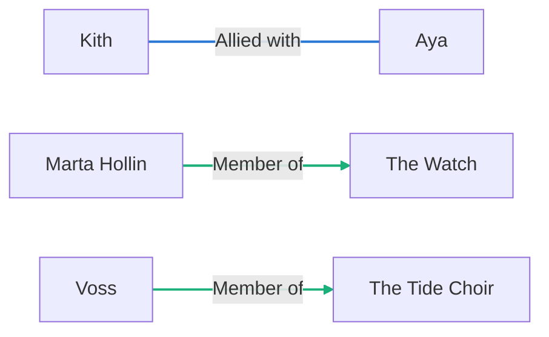
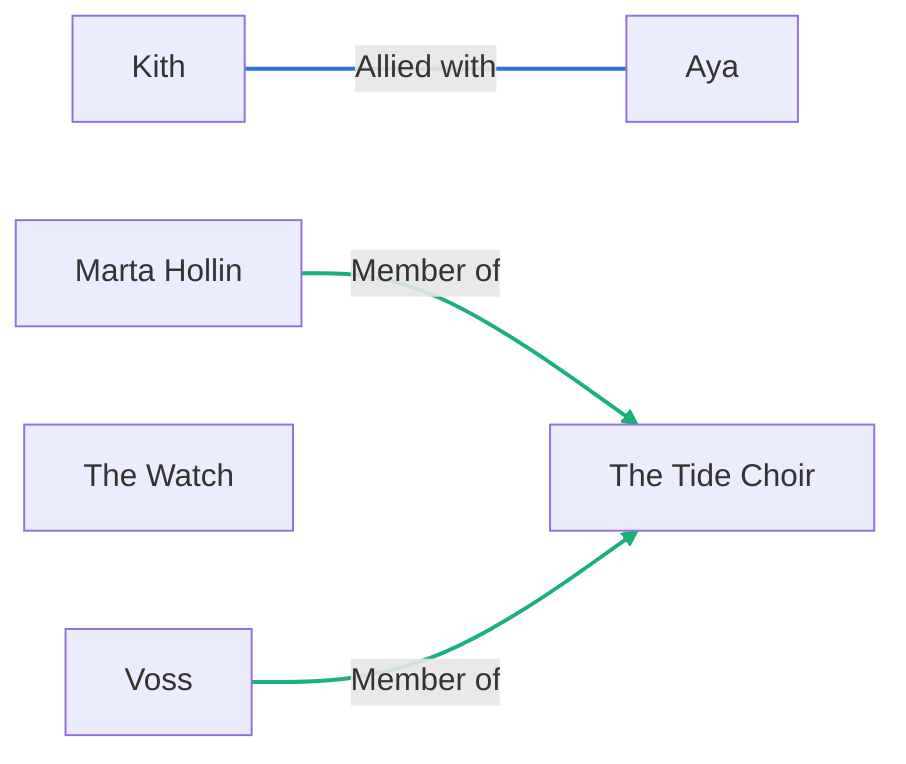
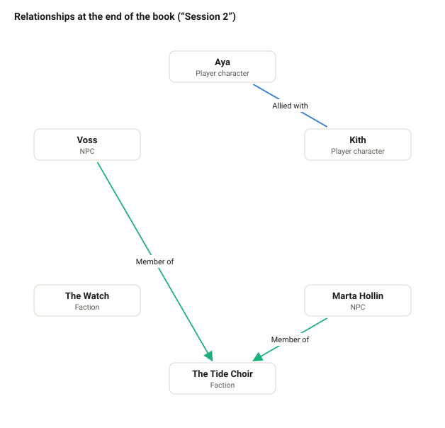
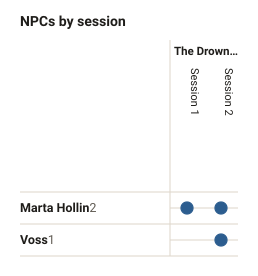
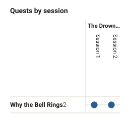
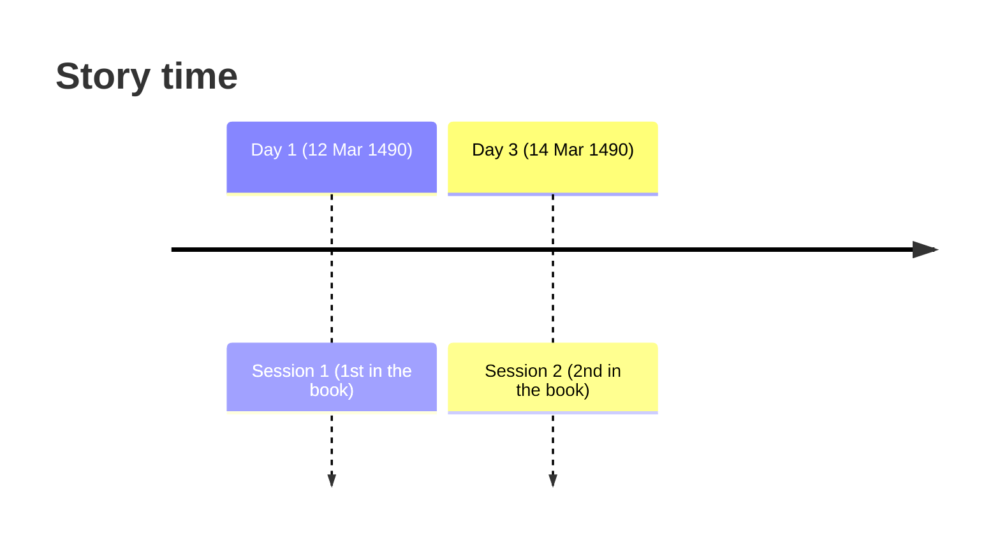
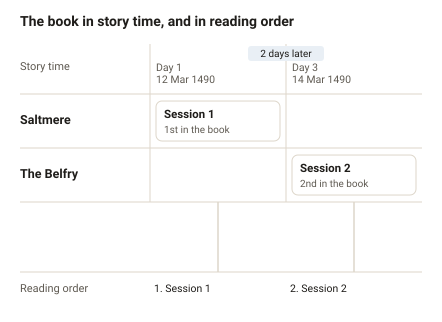

# Diagrams of The Drowned Bell

_Generated by Writer from the campaign's files: don't edit, it's rewritten when the story changes. Open the campaign in Writer for the live, editable views._

## Relationships

At the start of the book (“Session 1”):

At the end of the book (“Session 2”):

As drawn in Writer, where the nodes are placed by hand:

## Presence

Filled where the session lists them, dashed where the prose only mentions them. The number by each name is how many sessions it's in; shaded, an absence of more than three sessions.

## Timeline

When things happen in the story, next to where they come in the book.

