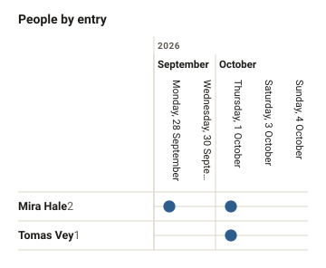
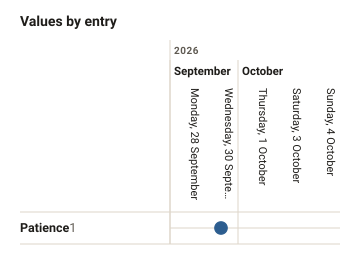
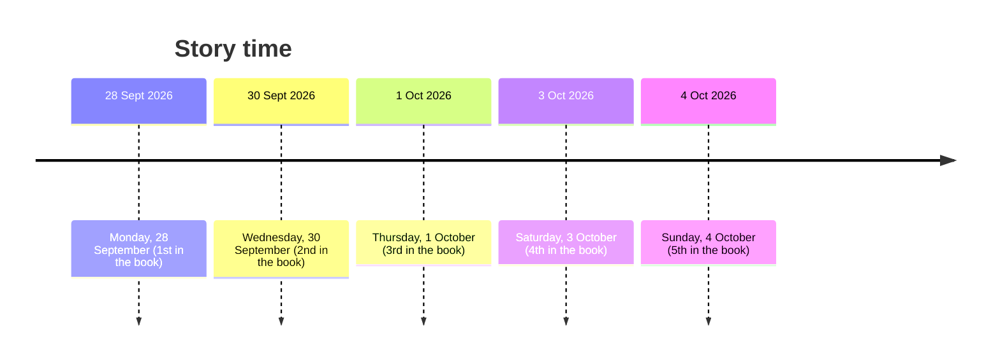
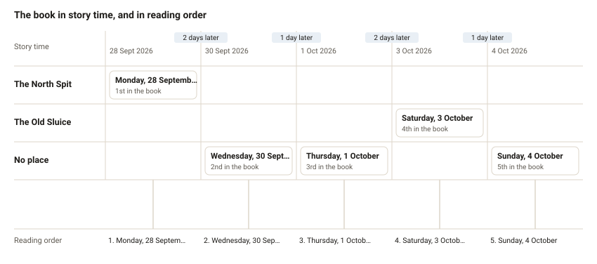

# Diagrams of A Year at the Estuary

_Generated by Writer from the novel's files: don't edit, it's rewritten when the story changes. Open the novel in Writer for the live, editable views._

## Relationships

No characters yet.

## Presence

Filled where the entry lists them (for values, larger for a stronger one), dashed where the prose only mentions them. The number by each name is how many entries it's in; shaded, an absence of more than three entries.

## Timeline

When things happen in the story, next to where they come in the book.

