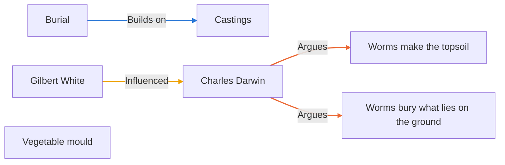
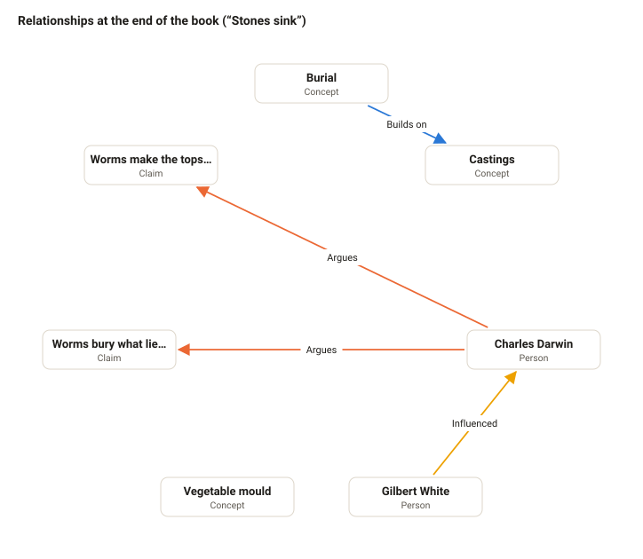
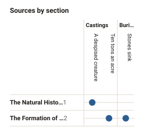
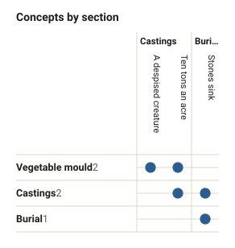

# Diagrams of Small Ploughs

_Generated by Writer from the non-fiction book's files: don't edit, it's rewritten when the story changes. Open the non-fiction book in Writer for the live, editable views._

## Relationships

At the start of the book (“A despised creature”):

At the end of the book (“Stones sink”):

As drawn in Writer, where the nodes are placed by hand:

## Presence

Filled where the section lists them, dashed where the prose only mentions them. The number by each name is how many sections it's in; shaded, an absence of more than three sections.

